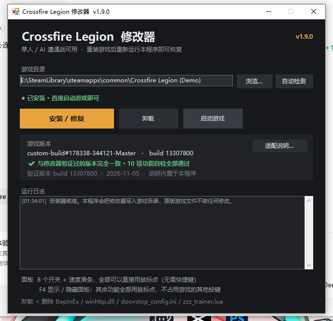
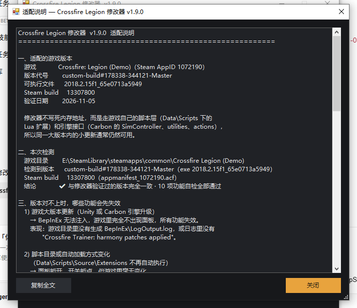

# Crossfire Legion 修改器

针对 Steam 游戏 **Crossfire: Legion (Demo)**（Unity + Carbon 引擎 + Mono）的单人修改器。
以 **BepInEx 插件 + Lua 脚本扩展**实现，不硬改内存地址、不改游戏本体文件，卸载即恢复原版。

> ⚠️ **只在单人 / 离线 AI 遭遇战 / 战役里用。** 联机对局请勿开启；此类工具通常违反游戏服务条款，风险自负。
> 本仓库不包含任何游戏文件，使用时需要你自备正版游戏。



## 功能

| 功能 | 说明 |
|---|---|
| 无限资源 | 每 0.5 秒把材料 / 燃料拉回设定值（10k / 50k / 200k / 999k 可切） |
| 友方无敌 / 锁血 | 对全部友方实体设 `IgnoreRemove` 交易模式，伤害无法扣除 HP / 护盾，每 1.5 秒刷新以覆盖新造单位 |
| 建造 / 生产加速 | 复用官方 buff `ba_campaign_production_time_fast`（ConstructionRate ×50）与 `ba_Production_set_to_2`（生产 1 秒） |
| 超级攻击力 | 官方 buff `ba_max_attack`，进入对局时把它的伤害值从自带的 1,000,000 改成 1,000（够秒任何单位，数值也不至于离谱） |
| 游戏速度 | 改引擎自己的 `SimController.TimeScale` + `Time.timeScale`，面板上是 0.5×–5× 的拖动滑条 |
| 立即完成建造 | `utilities.CompleteConstruction` |
| 指挥官能量无限 | 每 100 ms 读回 `ia_resource3`（上限 100），掉了就补满 |
| 兵种能量无限 | 兵种技能用的是另一条库存 `ia_mana`（面板上的紫条，每个单位各自一份、上限 100），每 200 ms 对**我方每个实体**写满；引擎按各自上限截断，所以不用管是哪个兵种 |
| 技能无冷却（含兵种） | 每 200 ms 对**我方每一个实体**（含指挥官本人）调 `utilities.ResetAbilityCooldowns(entity)`，指挥官技能与各兵种的主动技能冷却一起清 |
| 全图视野 | 调引擎未公开的 `utilities.ToggleFogOfWar(false, player)` 关掉战争迷雾，整张地图（含小地图）直接可见；再点一次恢复 |
| 移动速度翻倍 | 官方 buff `ba_mod_speed_200pc`（`MoverAttributes.MaximumSpeed`，乘法 ×2），我方每个单位各自翻倍、兵种之间原有快慢关系不变；新造单位 0.5 秒内自动补上，关闭后摘除 |
| 一键200人口 | 官方 buff `ba_pop_increase_200`（把 `Inventories[ia_population].Maximum` 覆盖成 200）；人口是挂在指挥官实体上的库存，所以只对有我方 `ia_population` 的实体生效，敌方不受影响 |
| 经验值直接编辑（≤5万） | 点面板上的「经验 N」栏弹出数字键盘，**会预填你当前的数值**，改完点「确定修改」直接把余额**替换**成新值（不是累加）；右侧「设为 5 万」可一键拉满。范围 0 - 50000，输入超过按 50000 处理，**大厅里就能用，不用打局**。经验值存在统计项 `isa_progressionxp_possesion_current`（`onlinedatacache\playerstats.json` 里那条，打一局胜利 +50）。游戏每次完成统计请求都会用缓存快照整体重建内存数据，直接改那条会被抹回 0，所以改由插件自己的余额账户托管：叠加到卡牌界面读取的 `ProgressionTotal` 上，升级扣费时对等扣减，余额存在 `BepInEx\config\CrossfireTrainer.xp.txt`，重启游戏不清零；面板底部实时显示当前持有量 |
| 卡牌全部升到20级 | 卡牌等级不是独立字段，而是**由每张卡的经验统计值对照兵种进阶表算出来的**（`rpfa_infantry` 12707 / `rpfa_air`·`rpfa_vehicle`·`rpfa_commander` 19061，共 20 档）。按钮把档案里所有卡的 `ProgressionXP` 统计一次性推到 19061，再走游戏自己的 `IStatisticsService.UpdatePlayerStats` 写入（同一路径会 `CachePlayerStats()` 落盘并触发 `OnPlayerStatisticsUpdated`），所以点完当场全部 20 级、不用重启。需要先打开一次卡牌界面，让插件拿到 stat-id → 卡牌的映射 |
| 我方自动判定 | 用 `utilities.IsLocalPlayer` 找本地玩家所在槽位，与排在第几号位无关；状态栏显示 `P6` 这类结果，`P1*` 表示退回兜底 |

> **只有一个快捷键：`F4` 显示 / 隐藏面板。**
> 其余功能全部用鼠标点面板，不再占用游戏自己的 F 键。

## 下载与安装

1. 到 [Releases](../../releases) 下载最新的 `Crossfire Legion 修改器 vX.Y.Z.exe`（单文件，约 720 KB，只需系统自带的 .NET Framework 4.8）。
2. 双击运行，它会自动找到 Steam 库里的游戏目录（找不到就点「浏览…」手动选，目录里应有 `Crossfire_Legion.exe`）。
3. 点「安装 / 修复」，等它显示 `已安装 · 直接启动游戏即可`。
4. 从 Steam 正常启动游戏，进入对局后按 `F4` 打开面板。

这个 exe 是**完全自包含**的：BepInEx 框架、插件 DLL、Lua 脚本（共 24 个文件）都内嵌在里面，
所以可以把它单独存到 U 盘 / 网盘，游戏卸载重装后重新跑一次就能一键恢复。

### 适配说明就在 exe 里

「游戏版本」卡片会读取游戏 exe 的 `ProductVersion` 与 Steam `buildid`，与验证过的版本比对，并对 14 项功能逐个自检；
右上角 **「适配说明…」** 会弹出完整说明：适配的是哪个版本、版本对不上时**哪些功能会先失效**、日志里搜什么、更新后怎么办。



这份说明只存在于 exe 内部，不会往游戏目录写任何说明文件。

命令行模式（排查问题用）：

```
"Crossfire Legion 修改器 v1.16.1.exe" --detect            只检测并打印游戏路径
"Crossfire Legion 修改器 v1.16.1.exe" --status            安装状态 + 版本判定
"Crossfire Legion 修改器 v1.16.1.exe" --compat            打印完整适配说明
"Crossfire Legion 修改器 v1.16.1.exe" --version           修改器版本与目标游戏版本
"Crossfire Legion 修改器 v1.16.1.exe" --install [目录]    静默安装
"Crossfire Legion 修改器 v1.16.1.exe" --uninstall [目录]  静默卸载
```

日志写在 `%TEMP%\CrossfireTrainerSetup.log`。

## 从源码构建

需要：Windows、[.NET SDK 8](https://dotnet.microsoft.com/download)、Python 3（打包脚本用）、
以及一份**已安装的游戏**——编译插件要引用游戏自带的 `UnityEngine.*.dll` 与 `Carbon.*.dll`。

```
git clone <this repo>
cd <repo>

# 1) 编译插件并部署到游戏目录（dll + lua）
cd CrossfireTrainer
set CFL_GAME_DIR=D:\SteamLibrary\steamapps\common\Crossfire Legion (Demo)
build.bat

# 2) 打包成单文件安装器，导出到仓库根目录
cd ..\TrainerSetup
build_setup.bat
```

也可以把游戏目录直接当参数传：`build.bat "D:\...\Crossfire Legion (Demo)"`。
`build_setup.bat` 的 payload 是**从游戏目录里收集**部署好的文件（含 `BepInEx\core`），
所以第一次构建前，游戏目录里需要已经有一份 BepInEx 5.4.23.2（x64）——
先跑一次已发布的安装器，或按 BepInEx 官方文档自行安装即可。

## 实现原理

1. **注入**：BepInEx 5.4（Mono + winhttp / Doorstop），插件随游戏启动加载。
2. **拿 Lua 环境**：Harmony 挂在 `Carbon.Simulation.SimScriptProcessor.OnInitialize`，
   反射取私有字段 `mLuaEnv`（LuaEnv）与 `mFrameController`（`SimController`）。
3. **线程安全**：Lua 只能在模拟线程调用，所有指令排队，在 `SimScriptProcessor.DoProcess` 的 Postfix 里执行。
4. **游戏速度**：`SimController.TimeScale` 是引擎自带接口（改 `"SimController Tick"` 协程周期），
   原版大厅的 Game Speed 选项走的就是这条路。
5. **建造 / 攻击 / 无敌**：全部复用游戏官方遗留的 Buff 与库存属性（可在 `Data/Attributes.zip` 里查到定义），
   只做 `ModifyBuff` / `SetInventoryValue`，不碰内存地址，所以游戏小版本更新通常仍然可用。

## 已知限制

- **Lua 文件必须是纯 ASCII**：引擎用 `Encoding.ASCII.GetByteCount()` 算长度却按 UTF-8 喂给 Lua，
  中文注释会让缓冲区被截断并报 `near <eof>`。
- 不能依赖 `events.AddListener(eventType.EveryFrame, ...)`：扩展加载时机注册的监听不会触发，改由 C# 侧定时驱动。
- 无敌是「伤害无法扣除」，不是把血条锁满；血条会停在当前值不再下降。
- 所有功能只作用于**本地玩家**一方，不碰 AI。
- 游戏大版本更新后，属性资源名或脚本接口可能变化；安装器与面板自检会提示是哪一项失效。

## 卸载

双击安装器 → 点「卸载」，会删掉 `BepInEx\`、`winhttp.dll`、`doorstop_config.ini`、`.doorstop_version`、
`Data\Scripts\Source\Extensions\zzz_trainer.lua`，游戏本体不受影响。
Steam「验证文件完整性」也能恢复 Lua 部分。

## 常见问题

- **游戏里不出现面板**：先看 `游戏目录\BepInEx\LogOutput.log`。
  没有这个文件 = 注入没生效，重新跑一次安装器；杀毒软件有时会把 `winhttp.dll`（Doorstop 注入器）当木马清掉，
  给游戏目录加白名单后重装即可。
- **面板出来了但某项没反应**：安装器里点「适配说明…」，对照里面列出的第 2、3、4 类原因，
  或把 `LogOutput.log` 里 `compat:` / `assets missing:` 两行贴到 Issue。
- **提示没有写入权限**：右键 exe →「以管理员身份运行」。

## 许可

本软件**仅供交流与学习**，为改善软件功能、提升用户体验等合法目的而制作。
本软件为**专有软件，保留所有权利**（见 [LICENSE](LICENSE)）。仅授权取得本软件的本人用于个人、非商业用途；
**禁止私自传播、修改、出售、再授权**，也禁止反编译、逆向工程、移除版权标识，或以任何形式打包进其他项目与合集。
完整条款见 [LICENSE](LICENSE)。

安装器内嵌的 BepInEx / Doorstop / HarmonyX / MonoMod / Mono.Cecil
遵循各自的许可，详见 [THIRD-PARTY-NOTICES.md](THIRD-PARTY-NOTICES.md)。
游戏本体与游戏资源版权归其开发商 / 发行商所有。
